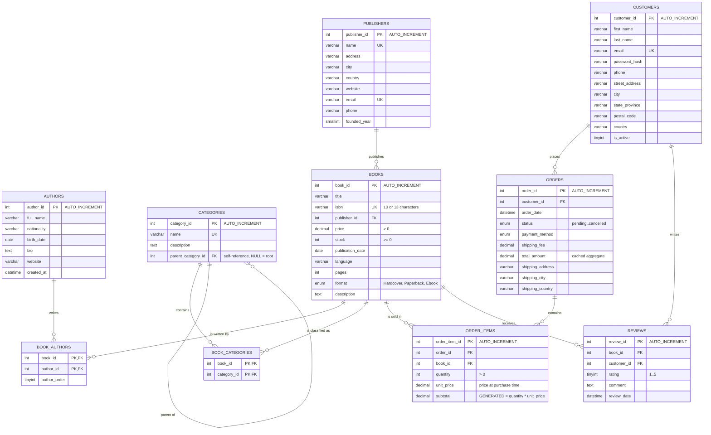

# Online Bookstore — Entity-Relationship Diagram

**Course:** INS3064 · **Homework 6:** Database Design
**Companion file:** [`bookstore_db.sql`](./bookstore_db.sql) (MySQL 8 / MariaDB 10.4, InnoDB, utf8mb4)

The database has **10 tables**:

| Reference data | Catalog + M:N links | Transactions |
|---|---|---|
| `authors`, `publishers`, `categories` | `books`, `book_authors`, `book_categories` | `customers`, `orders`, `order_items`, `reviews` |

---

## 1. How to read this ERD

| Notation | Meaning |
|---|---|
| `PK` | Primary key |
| `FK` | Foreign key |
| `UQ` | Unique key |
| `1:1` | Exactly one row on each side |
| `1:N` | One row on the parent side, many rows on the child side |
| `M:N` | Many rows on both sides, implemented by a junction table |
| `||--o{` | Crow's foot: exactly one (parent) to zero-or-many (child) |
| `1 ───<` | Text form of one-to-many (the `<` is the "many" end) |

All relationships in this schema are **1:N** or **M:N**; there are no 1:1 relationships.

---

## 2. Relationship map (crow's foot, text form)

```
  PUBLISHERS   1 ───< BOOKS                     (1:N, books.publisher_id)
  AUTHORS      1 ───< BOOK_AUTHORS >─── M BOOKS (M:N via book_authors)
  CATEGORIES   1 ───< BOOK_CATEGORIES >── M BOOKS (M:N via book_categories)
  CATEGORIES   1 ───< CATEGORIES                (1:N self-reference, parent_category_id)
  CUSTOMERS    1 ───< ORDERS                    (1:N, orders.customer_id)
  ORDERS       1 ───< ORDER_ITEMS >─── 1 BOOKS  (M:N via order_items)
  CUSTOMERS    1 ───< REVIEWS >─── 1 BOOKS      (two 1:N relationships)
```

Layered overview (reference data on top, transactions at the bottom):

```
REFERENCE DATA
  ┌──────────────────┐   ┌──────────────────┐   ┌───────────────────────┐
  │      AUTHORS     │   │    PUBLISHERS    │   │       CATEGORIES      │
  │ PK author_id     │   │ PK publisher_id  │   │ PK category_id        │
  │ UQ (none)        │   │ UQ name, email   │   │ UQ name               │
  │    full_name     │   │    address, city │   │ FK parent_category_id │──┐
  │    nationality   │   │    country       │   │    description        │  │ self
  └────────┬─────────┘   └────────┬─────────┘   └───────────┬───────────┘  │ 1:N
           │ 1                    │ 1                       │ 1            │
           │                      │                         │              │
           │ N                    │ N                       │ N            │
  ┌────────┴─────────┐   ┌────────┴─────────────────────────┴───────────┐  │
  │   BOOK_AUTHORS   │   │                    BOOKS                    │  │
  │ PK,FK book_id    │   │ PK book_id                                  │  │
  │ PK,FK author_id  │   │ UQ isbn                                     │  │
  │    author_order  │   │ FK publisher_id                             │  │
  └──────────────────┘   │    title, price, stock, publication_date... │  │
                         └──────┬────────────────────────────┬─────────┘  │
                                │ 1                          │ 1          │
                                │                            │            │
                                │ N                          │ N          │
  ┌──────────────────┐   ┌──────┴───────────┐   ┌────────────┴─────────┐  │
  │  BOOK_CATEGORIES │   │   ORDER_ITEMS    │   │        REVIEWS       │  │
  │ PK,FK book_id    │   │ PK order_item_id │   │ PK review_id         │  │
  │ PK,FK category_id│   │ FK order_id      │   │ FK book_id           │  │
  │                  │   │ FK book_id       │   │ FK customer_id       │  │
  │ (M:N of books    │   │    quantity      │   │    rating (1..5)     │  │
  │  and categories) │   │    unit_price    │   │    comment, date     │  │
  └──────────────────┘   │    subtotal      │   └────────────┬─────────┘  │
                         └──────┬───────────┘                │ N          │
                                │ N                          │            │
                                │                            │ 1          │
                          ┌─────┴────────┐          ┌────────┴─────────┐  │
                          │    ORDERS    │          │    CUSTOMERS     │◄─┘
                          │ PK order_id  │          │ PK customer_id   │
                          │ FK customer_id│         │ UQ email         │
                          │    status,   │          │    name, address │
                          │    total ... │          │    password_hash │
                          └──────────────┘          └──────────────────┘
```

---

## 3. Full ERD (Mermaid)

> Renders on GitHub, GitLab and VS Code with the Mermaid extension.
> `PK` = primary key, `FK` = foreign key, `UK` = unique key.



---

## 4. Entity dictionary

### 4.1 `authors`

| Column | Type | Constraints / notes |
|---|---|---|
| `author_id` | INT UNSIGNED | **PK**, AUTO_INCREMENT |
| `full_name` | VARCHAR(150) | **NOT NULL**; indexed for search |
| `nationality` | VARCHAR(60) | NULL |
| `birth_date` | DATE | NULL |
| `bio` | TEXT | NULL |
| `website` | VARCHAR(255) | NULL |
| `created_at` | DATETIME | NOT NULL, DEFAULT CURRENT_TIMESTAMP |

### 4.2 `publishers`

| Column | Type | Constraints / notes |
|---|---|---|
| `publisher_id` | INT UNSIGNED | **PK**, AUTO_INCREMENT |
| `name` | VARCHAR(150) | **NOT NULL**, **UQ** |
| `address` | VARCHAR(255) | NULL |
| `city` | VARCHAR(100) | NULL |
| `country` | VARCHAR(100) | **NOT NULL** |
| `website` | VARCHAR(255) | NULL |
| `email` | VARCHAR(150) | **UQ** (multiple NULLs allowed) |
| `phone` | VARCHAR(30) | NULL |
| `founded_year` | SMALLINT | NULL, **CHECK** 1400–2100 |
| `created_at` | DATETIME | NOT NULL, DEFAULT CURRENT_TIMESTAMP |

### 4.3 `categories`

| Column | Type | Constraints / notes |
|---|---|---|
| `category_id` | INT UNSIGNED | **PK**, AUTO_INCREMENT |
| `name` | VARCHAR(100) | **NOT NULL**, **UQ** |
| `description` | TEXT | NULL |
| `parent_category_id` | INT UNSIGNED | **FK** → `categories.category_id`, NULL = root category |
| `created_at` | DATETIME | NOT NULL, DEFAULT CURRENT_TIMESTAMP |

**Relationship:** `categories` 1:N `categories` (self), `ON DELETE SET NULL` so deleting a genre promotes its children to root instead of deleting books.

### 4.4 `books`

| Column | Type | Constraints / notes |
|---|---|---|
| `book_id` | INT UNSIGNED | **PK**, AUTO_INCREMENT |
| `title` | VARCHAR(255) | **NOT NULL**, prefix-indexed |
| `isbn` | VARCHAR(13) | **NOT NULL**, **UQ**, **CHECK** length 10 or 13 |
| `publisher_id` | INT UNSIGNED | **NOT NULL**, **FK** → `publishers` |
| `price` | DECIMAL(10,2) | **NOT NULL**, **CHECK** > 0 |
| `stock` | INT | **NOT NULL**, DEFAULT 0, **CHECK** >= 0 |
| `publication_date` | DATE | **NOT NULL**, indexed |
| `language` | VARCHAR(30) | **NOT NULL**, DEFAULT `'English'` |
| `pages` | INT | NULL, **CHECK** > 0 |
| `format` | ENUM | `Hardcover` / `Paperback` / `Ebook`, DEFAULT `'Paperback'` |
| `description` | TEXT | NULL |
| `cover_image_url` | VARCHAR(500) | NULL |
| `created_at` | DATETIME | NOT NULL, DEFAULT CURRENT_TIMESTAMP |
| `updated_at` | DATETIME | NOT NULL, DEFAULT CURRENT_TIMESTAMP, ON UPDATE CURRENT_TIMESTAMP |

### 4.5 `book_authors` (junction, M:N)

| Column | Type | Constraints / notes |
|---|---|---|
| `book_id` | INT UNSIGNED | **PK**, **FK** → `books`, `ON DELETE CASCADE` |
| `author_id` | INT UNSIGNED | **PK**, **FK** → `authors`, `ON DELETE CASCADE` |
| `author_order` | TINYINT UNSIGNED | **NOT NULL**, DEFAULT 1, **CHECK** >= 1 |

**Keys:** composite **PK** `(book_id, author_id)` prevents duplicate pairs; **UQ** `(book_id, author_order)` keeps the byline order unambiguous.

### 4.6 `book_categories` (junction, M:N)

| Column | Type | Constraints / notes |
|---|---|---|
| `book_id` | INT UNSIGNED | **PK**, **FK** → `books`, `ON DELETE CASCADE` |
| `category_id` | INT UNSIGNED | **PK**, **FK** → `categories`, `ON DELETE CASCADE` |

**Key:** composite **PK** `(book_id, category_id)`. A book can sit in several categories (e.g., *Sapiens* is History and Non-Fiction).

### 4.7 `customers`

| Column | Type | Constraints / notes |
|---|---|---|
| `customer_id` | INT UNSIGNED | **PK**, AUTO_INCREMENT |
| `first_name` | VARCHAR(60) | **NOT NULL** |
| `last_name` | VARCHAR(60) | **NOT NULL** |
| `email` | VARCHAR(150) | **NOT NULL**, **UQ**, **CHECK** contains `@` and `.` |
| `password_hash` | VARCHAR(255) | **NOT NULL**, **CHECK** length >= 20; bcrypt hashes only, never plaintext |
| `phone` | VARCHAR(30) | NULL |
| `street_address` | VARCHAR(255) | NULL |
| `city` | VARCHAR(100) | NULL |
| `state_province` | VARCHAR(100) | NULL |
| `postal_code` | VARCHAR(20) | NULL |
| `country` | VARCHAR(100) | **NOT NULL** |
| `is_active` | TINYINT(1) | **NOT NULL**, DEFAULT 1, **CHECK** IN (0,1) |
| `created_at` | DATETIME | NOT NULL, DEFAULT CURRENT_TIMESTAMP |
| `updated_at` | DATETIME | NOT NULL, DEFAULT CURRENT_TIMESTAMP, ON UPDATE CURRENT_TIMESTAMP |

### 4.8 `orders`

| Column | Type | Constraints / notes |
|---|---|---|
| `order_id` | INT UNSIGNED | **PK**, AUTO_INCREMENT |
| `customer_id` | INT UNSIGNED | **NOT NULL**, **FK** → `customers`, `ON DELETE RESTRICT` |
| `order_date` | DATETIME | **NOT NULL**, DEFAULT CURRENT_TIMESTAMP |
| `status` | ENUM | `pending` / `processing` / `shipped` / `delivered` / `cancelled`, DEFAULT `'pending'` |
| `payment_method` | ENUM | `credit_card` / `paypal` / `bank_transfer` / `cash_on_delivery`, DEFAULT `'credit_card'` |
| `shipping_fee` | DECIMAL(10,2) | **NOT NULL**, DEFAULT 0.00, **CHECK** >= 0 |
| `total_amount` | DECIMAL(12,2) | **NOT NULL**, DEFAULT 0.00, **CHECK** >= 0; cached aggregate |
| `shipping_address` | VARCHAR(255) | **NOT NULL**; delivery snapshot |
| `shipping_city` | VARCHAR(100) | **NOT NULL**; delivery snapshot |
| `shipping_state` | VARCHAR(100) | NULL |
| `shipping_postal_code` | VARCHAR(20) | NULL |
| `shipping_country` | VARCHAR(100) | **NOT NULL** |
| `notes` | VARCHAR(500) | NULL |
| `updated_at` | DATETIME | NOT NULL, DEFAULT CURRENT_TIMESTAMP, ON UPDATE CURRENT_TIMESTAMP |

### 4.9 `order_items` (junction, M:N)

| Column | Type | Constraints / notes |
|---|---|---|
| `order_item_id` | INT UNSIGNED | **PK**, AUTO_INCREMENT |
| `order_id` | INT UNSIGNED | **NOT NULL**, **FK** → `orders`, `ON DELETE CASCADE` |
| `book_id` | INT UNSIGNED | **NOT NULL**, **FK** → `books`, `ON DELETE RESTRICT` |
| `quantity` | INT | **NOT NULL**, DEFAULT 1, **CHECK** > 0 |
| `unit_price` | DECIMAL(10,2) | **NOT NULL**, **CHECK** > 0; price at purchase time |
| `subtotal` | DECIMAL(12,2) | **GENERATED ALWAYS AS** `quantity * unit_price` **STORED** |

**Keys:** **UQ** `(order_id, book_id)` — one line per book per order (the quantity is increased instead of adding a second line).

### 4.10 `reviews`

| Column | Type | Constraints / notes |
|---|---|---|
| `review_id` | INT UNSIGNED | **PK**, AUTO_INCREMENT |
| `book_id` | INT UNSIGNED | **NOT NULL**, **FK** → `books`, `ON DELETE CASCADE` |
| `customer_id` | INT UNSIGNED | **NOT NULL**, **FK** → `customers`, `ON DELETE CASCADE` |
| `rating` | TINYINT | **NOT NULL**, **CHECK** 1–5 |
| `comment` | TEXT | NULL |
| `review_date` | DATETIME | **NOT NULL**, DEFAULT CURRENT_TIMESTAMP |

**Key:** **UQ** `(book_id, customer_id)` — a customer can review a given book only once.

---

## 5. Relationships and referential actions

| # | Parent | Child | Cardinality | FK column(s) | ON DELETE | ON UPDATE |
|---|---|---|---|---|---|---|
| 1 | `publishers` | `books` | 1:N | `books.publisher_id` | RESTRICT | CASCADE |
| 2 | `authors` | `book_authors` | 1:N | `book_authors.author_id` | CASCADE | CASCADE |
| 3 | `books` | `book_authors` | 1:N | `book_authors.book_id` | CASCADE | CASCADE |
| 4 | `categories` | `book_categories` | 1:N | `book_categories.category_id` | CASCADE | CASCADE |
| 5 | `books` | `book_categories` | 1:N | `book_categories.book_id` | CASCADE | CASCADE |
| 6 | `categories` | `categories` | 1:N (self) | `categories.parent_category_id` | SET NULL | CASCADE |
| 7 | `customers` | `orders` | 1:N | `orders.customer_id` | RESTRICT | CASCADE |
| 8 | `orders` | `order_items` | 1:N | `order_items.order_id` | CASCADE | CASCADE |
| 9 | `books` | `order_items` | 1:N | `order_items.book_id` | RESTRICT | CASCADE |
| 10 | `customers` | `reviews` | 1:N | `reviews.customer_id` | CASCADE | CASCADE |
| 11 | `books` | `reviews` | 1:N | `reviews.book_id` | CASCADE | CASCADE |

**Why these actions?**

- **CASCADE** — dependants that have no meaning without the parent: order lines of a deleted order, junction rows of a deleted book/author/category, reviews of a deleted book or customer.
- **RESTRICT** — business records that must survive: a publisher with books, a customer with orders, and a book that appears in any order history cannot be deleted. Inactive books/customers are deactivated (`customers.is_active = 0`) or kept with zero stock instead.
- **SET NULL** — an optional reference: deleting a parent genre does not delete its sub-genres; they become root categories.
- **ON UPDATE CASCADE** — all keys are surrogate `INT`s that never change in practice; the rule simply keeps references valid if a key is ever renumbered.

---

## 6. Normalization summary (3NF)

The full reasoning is in the header of [`bookstore_db.sql`](./bookstore_db.sql); this is the checklist.

| Table | 1NF (atomic) | 2NF (no partial dependency) | 3NF (no transitive dependency) |
|---|---|---|---|
| `authors` | One scalar per column | Single-column PK | Bio/nationality depend only on `author_id` |
| `publishers` | Address split into columns | Single-column PK | Publisher details depend only on `publisher_id` |
| `categories` | One value per column | Single-column PK | Parent stored as `parent_category_id`, never as parent name |
| `books` | No list of authors/categories | Single-column PK | `publisher_id` only; no publisher name/address duplicated |
| `book_authors` | One pair per row | `author_order` depends on the **whole** key `(book_id, author_id)` | No non-key → non-key dependency |
| `book_categories` | One pair per row | No non-key attributes at all | No non-key → non-key dependency |
| `customers` | Address split into columns | Single-column PK | City/postal code describe the customer row, not each other |
| `orders` | Address split into columns | Single-column PK | `customer_id` only; no customer name/email copied |
| `order_items` | One book per line | Single-column PK | `subtotal` is generated; title/ISBN not duplicated |
| `reviews` | One review per row | Single-column PK | Reviewer name and book title reached via FKs |

**Deliberate, documented exceptions:**

1. `orders.shipping_*` is a **historical snapshot** of the delivery address. If a customer later changes their address, old orders must keep the address the parcel was sent to.
2. `order_items.unit_price` is the **price actually charged**, not today's `books.price`.
3. `orders.total_amount` is a **cached aggregate** of `order_items.subtotal + shipping_fee`. It is not a transitive dependency on another `orders` column; the view `v_order_summary` recomputes it, and every sample row matches.

---

## 7. Sample data coverage

| Table | Rows | Coverage highlights |
|---|---|---|
| `authors` | 11 | 2 co-author teams (4 GoF authors, 2 *Pragmatic Programmer* authors) |
| `publishers` | 4 | All 4 publishers own at least one book |
| `categories` | 7 | Two roots (`Fiction`, `Non-Fiction`) with 5 sub-genres |
| `books` | 9 | Every publisher and every category used; 1 book in 2 categories |
| `book_authors` | 13 | M:N proven by multi-author books |
| `book_categories` | 10 | M:N proven by multi-category book |
| `customers` | 5 | 3 countries; all have complete addresses |
| `orders` | 6 | All 5 statuses used; one customer orders twice |
| `order_items` | 14 | 6 orders, up to 3 lines each; every book sold at least once |
| `reviews` | 12 | Ratings 3–5; no duplicate `(book, customer)` pair |

Sanity checks executed during verification:

- All 6 stored order totals equal `SUM(order_items.subtotal) + shipping_fee`.
- Invalid inserts are rejected: rating 6, price 0, quantity 0, duplicate ISBN/email/review, unknown publisher.
- Deleting a publisher/customer/book with history is blocked (RESTRICT).
- Deleting an order removes its order items (CASCADE); rollback restores them.
- Deleting a parent category sets children `parent_category_id = NULL`.
